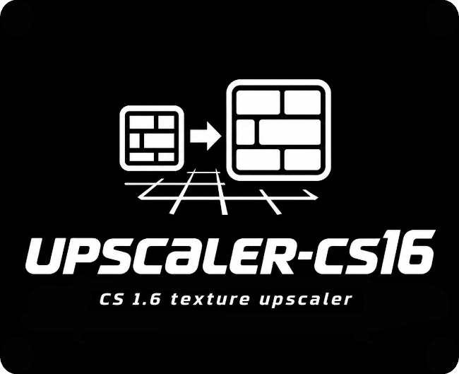
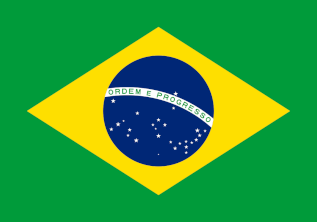

# upscaler-cs16



Upscale the textures of your **Counter-Strike 1.6** maps. Point it at your
game folder, leave it running, and every map comes back with textures at up
to 1024 px and with much better detail and resolution.

```sh
./upscaler-cs16.bash
```

It reads the BSP and WAD3 files **directly**, so no Wine and no Windows
component is involved, and it works out the exact set of textures each map
actually uses rather than extracting whole WAD files. Each distinct image is
named after the hash of its own content, so identical pixels become one file
and are upscaled once however many maps share them.

**IMPORTANT:** My life, my work and my passion is free software. Corrections, tweaks and improvements are very welcome (**pull requests** 😉)! Please consider giving us a ⭐, fork, support this project or even visit our professional profile (see [About](#about)). **Thanks!** 🤗

**Support free software and my work!** ❤️🐧

## Table of Contents

- [Layout](#layout)
- [Requirements](#requirements)
   * [1. The tools](#1-the-tools)
   * [2. The game side](#2-the-game-side)
- [Installation](#installation)
- [Configuration](#configuration)
- [Running it](#running-it)
   * [Resuming](#resuming)
- [What it does to your game](#what-it-does-to-your-game)
- [How the textures are found](#how-the-textures-are-found)
- [Why the file names are hashes](#why-the-file-names-are-hashes)
- [Transparency](#transparency)
- [Logs](#logs)
- [Troubleshooting](#troubleshooting)
- [Tests](#tests)
- [Limitations](#limitations)
- [About](#about)

## Layout

```
upscaler-cs16/
├── upscaler-cs16.bash      # run this
├── config_model.bash       # the settings template, tracked by git
├── config.bash             # YOURS, copied from the template; not tracked
├── tools/
│   └── cs16_assets.py          # the native BSP and WAD3 reader
├── black_list.txt          # textures that must never be replaced
├── ez_i/                   # github.com/eduardolucioac/ez_i
├── json-like/              # github.com/eduardolucioac/json-like
├── logs/                   # written as it runs
├── images/
├── LICENSE
└── README.md               # this file
```

---

## Requirements

### 1. The tools

| Requirement | Why |
|---|---|
| **BASH 4.3+** | the libraries rely on namerefs (`local -n`) |
| **Python 3** with **Pillow** and **NumPy** | reading BSP and WAD3, and writing the PNGs |
| **ImageMagick** | resizing and sharpening |
| **oxipng** | lossless PNG compression (optional, see `PNG_COMPRESS_LEVEL`) |
| **Real-ESRGAN ncnn/Vulkan** | the upscaling itself |
| **A Vulkan capable GPU** | the upscalers run on it |

Arch and derivatives:

```sh
sudo pacman -S --needed imagemagick oxipng python-pillow python-numpy
paru -S realesrgan-ncnn-vulkan-bin
```

That package ships the models too, under
`/usr/share/realesrgan-ncnn-vulkan/models/` — `realesrgan-x4plus`,
`realesrgan-x4plus-anime` and `realesr-animevideov3` at 2x, 3x and 4x.

Debian and derivatives:

```sh
sudo apt-get install imagemagick oxipng python3-pil python3-numpy
```

Real-ESRGAN is not packaged in Debian; take the release from
[Real-ESRGAN-ncnn-vulkan](https://github.com/xinntao/Real-ESRGAN-ncnn-vulkan/releases)
and put the binary on your `PATH`, with its `models` folder beside it.

**NOTE:** Everything is checked before the run starts, and everything that is
missing is reported at once rather than one per attempt.

#### Which model

The default is **`realesrgan-x4plus`**, the general purpose one: a large
network trained on real world photographs, which is what CS 1.6 textures
mostly are — brick, concrete, metal, wood, fabric.

It is a **fixed 4x** model, so every texture is taken to 4x and resized down
to `TARGET_MAX_PX`. That is not a compromise: the downscale averages away
the artefacts the network leaves, so the result is generally **better** than
asking for the exact factor. It is supersampling. What it costs is time, and
peak disk for the intermediate images.

`realesr-animevideov3` is the alternative — a small network trained for
**anime video**. Much faster, and it takes 2, 3 and 4 as factors rather than
only 4, but on photographic material it flattens detail. Worth it only on
hardware that cannot afford the other, and it means changing both
`REALESRGAN_MODEL` and `UPSCALE_FACTORS`.

### 2. The game side

The upscaled textures are loaded through the **detail texture** mechanism,
which the stock engine does not support at these sizes. You need:

- **Metahook Plus 0.4** — a client plugin platform for GoldSrc;
- **Meta Renderer 1.5c** — the plugin that actually reads the `*_extra.txt`
  files this produces.

Installing those is outside the scope of this README, and worth doing
carefully: **back your game up first**.

Tested against **CS 1.6 build 4554 (non steam)**. Your maps must already be
working: every WAD the maps need in `cstrike` or in `valve`, and every skybox
TGA in `cstrike/gfx/env`.

Newer builds live at [MetaHookSv](https://github.com/hzqst/MetaHookSv) and
[this guide](https://www.reddit.com/r/CS16OldModders/comments/wlhwa4/install_metahooksv_in_counterstrike_16_a_nonsteam/)
is a good path through them, but installing those is fiddly and whether this
works against them is **untested**. Use the versions named above.

---

## Installation

```sh
git clone https://github.com/eduardolucioac/upscaler-cs16.git
cd upscaler-cs16
chmod a+x upscaler-cs16.bash
cp config_model.bash config.bash
```

The two libraries under `ez_i/` and `json-like/` come with it. Nothing is
compiled and nothing else is downloaded.

**That last line is not optional.** The script will not run without a
`config.bash`, and it says so rather than starting with every setting
empty.

## Configuration

`config.bash` is **yours**. It is not part of the project and git does not
track it, so pulling a new version never overwrites your paths and your
paths never end up in a commit. What the project carries is
`config_model.bash`, which is also where a new setting shows up — compare
the two after an update to see what changed.

Open **`config.bash`**. Every parameter is documented inline; the only one
you must set is the first:

```bash
WORK_FOLDER="/path/to/Counter Strike 1.6/Counter Strike 1.6 RE-MOD"
```

That is the folder holding the main CS 1.6 executable (`hl.exe`, for
instance). Everything else is derived from it, `WORK_FOLDER_VALVE` included:
the WADs of the mod are read first and those of the base game after them,
which is the order the engine searches in. In a stock installation
`halflife.wad`, `decals.wad`, `liquids.wad`, `xeno.wad` and `gfx.wad` live
only in `valve` — measured on a real installation with those taken out of
`cstrike`, 83 texture names across 14 of 81 maps had nowhere to come from,
and `valve` answered 81 of them.

**IMPORTANT:** Windows folder names are case INsensitive and Linux ones are
not. The script matches the names it reads out of the BSPs case
insensitively, but this path is yours and must be exact.

The ones worth knowing about:

| Parameter | Default | Purpose |
|---|---|---|
| `REALESRGAN_MODEL` | `realesrgan-x4plus` | **must match `UPSCALE_FACTORS`** |
| `UPSCALE_FACTORS` | `4` | the factors the model really accepts |
| `TARGET_MAX_PX` | `1024` | size of each texture's largest dimension |
| `TRY_MAX_PX` | `1` | overshoot and resize down rather than undershoot |
| `SHARPEN_IMGS` | `1` | `1~3`, or `-1` to turn it off |
| `PNG_COMPRESS_LEVEL` | `3` | `oxipng` level, or `-1` to skip it |
| `RSRGAN_ENABLE_TTA` | `0` | up to 15% more quality for up to 8x the time |
| `STOP_WAD_SKYNAME_MISSING` | `1` | stop when a map needs something no WAD has |
| `HASH_LENGTH` | `16` | **changing it renames every output file** |

## Running it

```sh
./upscaler-cs16.bash
```

It opens with what it is, asks you to accept the licence, checks the tools,
scans your maps and then tells you what it found before anything is written:

```
Your 5 map(s) use 519 textures, which are only 515 DISTINCT
images (plus 19 distinct "skyname" sides). Each distinct image is upscaled
once, so that is all the work there is.

This will use APPROXIMATELY 0.45 GB on your disk.
Your free disk space is 118 GB.
Is this OK for you?
```

Then it backs up what it is about to touch and gets to work, saying how far
along it is and how long is left:

```
 > PNG finished (texture): .../gfx/detail/_upscaled/c90fc1bf95bea8e1.png
ITEMS LEFT 312/534 (41% SO FAR) / TIME LEFT 23m 14s
```

**HOW LONG IT TAKES DEPENDS ALMOST ENTIRELY ON YOUR MACHINE.** A full run
over the five map sample — 534 distinct images — took **6 and a half
minutes** on an RTX 5070 Laptop:

```
scan                1s
export              2s
upscale (4x)     1m38s     <- the GPU
finish           4m39s     <- resize, sharpen, oxipng; CPU bound
```

The slow part is not the AI. On older hardware, or with
`RSRGAN_ENABLE_TTA=1`, the same work runs for hours. Either way it is
interruptible; see below.

### Resuming

Press **Ctrl+c** whenever you like. The next run offers to carry on:

```
There is an unfinished upscale process.
Do you want to resume it? ("y" highly recommended)
```

Nothing already produced is redone. Every step skips what is already on
disk, so even starting over costs only what is actually missing.

---

## What it does to your game

**Created**

- `cstrike/gfx/detail/_upscaled/` — the upscaled textures;
- `cstrike/gfx/env/_upscaled/` — the upscaled skybox sides;
- `cstrike/maps/<map>_extra.txt` — one per map, mapping each texture NAME
  onto the file that replaces it.

**Backed up first**, as `.tar.gz`, before anything else happens

- the `detail` and `env` folders, and the `*_detail.txt` files.

**Moved out of `cstrike`**, into that backup

- whatever `gfx/detail` already held — the old per map detail folders, which
  the upscaled images replace. `gfx/env` is *copied* instead, and stays.

**Removed**, once its replacement is written and it is safely in that backup

- `cstrike/maps/<map>_detail.txt`. It is what the engine reads *without* the
  renderer plugin, and it points at the per map folders under `gfx/detail`
  that the backup moved away, so leaving it would have the engine chase
  files that are not there.

**Deleted**, but only when you ask for it

- the upscaled images of an earlier run, when `REDO_ALL` is `1`. The
  backups are never touched.

**Never touched**

- your **WAD files**. They are only ever read.

Once it is done, enable the detail textures in the CS 1.6 console:

```
r_detailtextures 1
r_detailtexturessupported 1
gl_max_size 16384
gl_texturemode GL_LINEAR_MIPMAP_LINEAR
```

To keep them, put those in `cstrike/userconfig.cfg`.

---

## How the textures are found

This is the part that makes the rest cheap.

A map's BSP carries a **texture lump** that IS the exact list of the textures
that map uses, each with its dimensions. A texture is either **embedded**
there — the compiler copied the pixels into the map — or **external**, which
means the lump names it and the pixels stay in a WAD.

So there is no need to extract whole WADs and hope, no need to brute force
search the BSP binary for names, and no need to decide which WADs a map
"really" uses: only the handful of names a map leaves external are ever
looked up, and only those are read.

On the project's own test sample, 4 of the 5 maps have **every** texture
embedded, and the WAD paths their `wad` key lists are the author's build time
paths that exist nowhere. The difference that makes:

```
                                      images to upscale
extracting every WAD                         4075
driven by the BSP                             533     ->  86.9% fewer
```

Textures the engine never draws — `CLIP`, `AAATRIGGER`, `ORIGIN`, `SKY`,
`NULL` and the rest — are skipped, since replacing them would cost time and
disk for nothing.

## Why the file names are hashes

A texture's name is not unique: two WADs can each carry a `bild1` and they
can be different images. And the same image turns up in many maps, sometimes
under a different name.

Naming each output file after the hash of its own **content** makes identical
pixels one file, upscaled once, and makes the whole run idempotent — anything
already on disk is already done. The `*_extra.txt` files are what map each
map's texture NAME onto the right hash, which is exactly what that format is
for.

## Transparency

Textures whose name starts with `{` are masked: palette index 255 is the
transparent one. That index is read **directly**, so the cut out is exact.

That matters because the key colour is not always `#0000ff` — in the
project's own sample, `{ikcanopt` uses `(0, 0, 252)`. Matching the colour
with a tolerance, which is the usual approach, either misses those or eats
real blue pixels out of the texture.

## Logs

Written to `logs/output/` and `logs/error/`, one timestamped file per run,
and the last `LOGS_KEEP` of each are kept.

The error log is where to look for the two things worth knowing about: a
texture a map needs that no WAD provides, and a texture name carried by more
than one of a map's WADs (that one goes to the output log, so you can check
the cases that actually matter — see `WAD_LAST_WINS`).

---

## Troubleshooting

**`find_blob_index_by_name data failed`**

The model does not take the factor it was asked for, which means
`REALESRGAN_MODEL` and `UPSCALE_FACTORS` disagree. `realesrgan-x4plus` is
a FIXED 4x model, whatever its options suggest, so it needs
`UPSCALE_FACTORS="4"`. `realesr-animevideov3` really does take 2, 3 and 4.

**"There is/are texture(s) and/or `skyname` file(s) that no WAD provides"**

A map needs something that is not there — nothing in `cstrike` and nothing in
`valve` carries it. The error log names each one. Put the missing WAD in
`cstrike`, or set `STOP_WAD_SKYNAME_MISSING=0` to process everything else and
leave those maps incomplete.

**Nothing changed in the game**

Metahook Plus and Meta Renderer are what read the `*_extra.txt` files. Check
that they are loaded, and that `r_detailtextures` is `1`.

**A texture looks wrong**

Add it to `black_list.txt` and run again. One name per line; `map_or_wad/name`
blocks it only when it comes from that source, a bare `name` blocks it
everywhere.

## Tests

Each library carries its own:

```sh
./ez_i/test/test.bash
./json-like/test/test.bash
```

## Limitations

- **Results depend on your maps.** Very small or poor source textures will
  not improve much. Do not expect a miracle — expect better definition and
  clarity in general, and a few textures that need a manual touch.

## About

upscaler-cs16 🄯 BSD-3-Clause  
Eduardo Lúcio Amorim Costa  
Brazil-ES  
https://www.linkedin.com/in/eduardo-software-livre/


